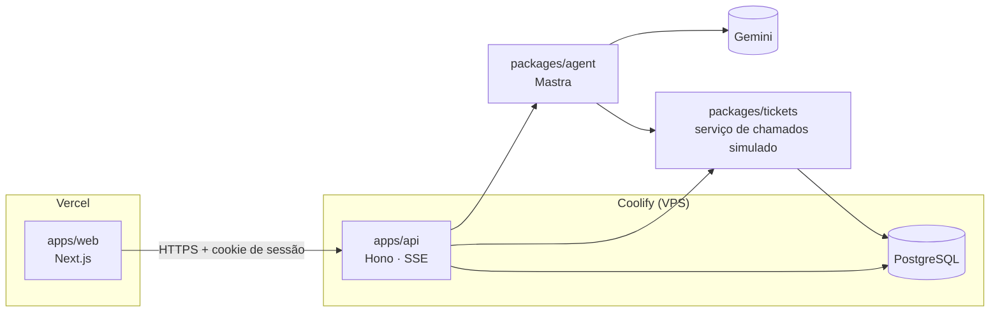
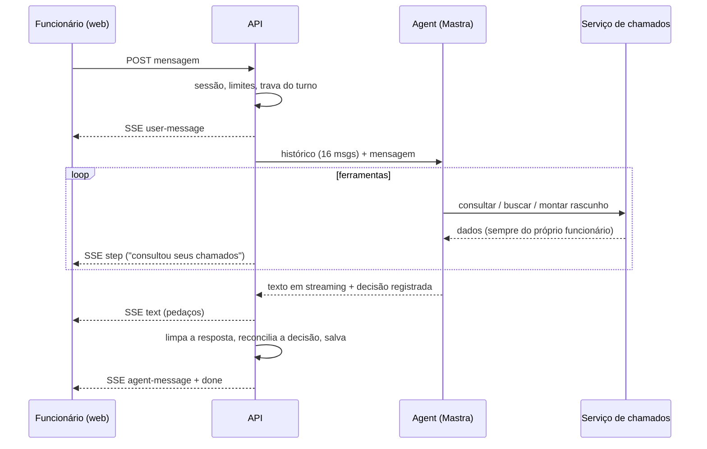

# Nexo Assist

Agent de atendimento do service desk de TI da Nexo. O funcionário descreve o problema com as próprias palavras, e o agent consulta os chamados dele, busca na central de ajuda, abre ou atualiza chamados com confirmação e chama um analista quando precisa. Do outro lado, o analista tem um console para assumir conversas, responder e devolvê-las ao agent.

| | |
|---|---|
| **Aplicação** | https://nexo.jcrldev.com |
| **API** | https://api.nexo.jcrldev.com/health |
| **Repositório** | https://github.com/Julio-Lopes/nexo-assist |

**Acesso de demonstração** (qualquer senha; os atalhos estão na tela de login):

| Perfil | E-mail |
|---|---|
| Funcionária (5 chamados, um vencido) | `ana.souza@nexo.com.br` |
| Funcionário (Windows 10) | `bruno.tavares@nexo.com.br` |
| Analista N2 | `rafael.lima@nexo.com.br` |
| Analista N1 | `patricia.gomes@nexo.com.br` |

> O cookie de sessão pertence ao domínio da API. Para testar funcionário e analista ao mesmo tempo, use uma janela anônima para um deles. Os dados de demonstração são recriados todo dia às 3h.

---

## Sumário

1. [Como rodar](#como-rodar)
2. [Arquitetura](#arquitetura)
3. [Como o agent decide](#como-o-agent-decide)
4. [Transparência das decisões](#transparência-das-decisões)
5. [Como garanti a qualidade das decisões](#como-garanti-a-qualidade-das-decisões)
6. [Escolha do modelo](#escolha-do-modelo)
7. [Deploy e proteções](#deploy-e-proteções)
8. [Trade-offs](#trade-offs)
9. [O que faria com mais tempo](#o-que-faria-com-mais-tempo)

---

## Como rodar

Pré-requisitos: **Node 22+**, **Docker** e uma chave gratuita do Gemini em [aistudio.google.com/apikey](https://aistudio.google.com/apikey).

### Opção 1: tudo em Docker (um comando)

```bash
cp .env.example .env            # e preencha GOOGLE_GENERATIVE_AI_API_KEY
docker compose --profile app up --build
```

Abra http://localhost:3000. No primeiro boot a API aplica as migrations e, com o banco vazio, cria os dados de demonstração.

### Opção 2: desenvolvimento

```bash
corepack enable
pnpm install
cp .env.example .env            # e preencha GOOGLE_GENERATIVE_AI_API_KEY
pnpm db:up                      # Postgres local
pnpm db:migrate
pnpm db:seed
pnpm dev                        # web :3000, api :4000, pacotes em watch
```

### Testes e avaliação

```bash
pnpm test     # unitários + integração (precisa do Postgres: pnpm db:up)
pnpm eval     # avaliação do agent contra o Gemini (~10 min no free tier)
```

Os testes de integração usam bancos isolados (`nexo_test_tickets`, `nexo_test_api`, `nexo_eval`), criados pelo script de init do Postgres num volume novo. Num volume que já existe:

```bash
docker exec nexo-db psql -U nexo -d nexo -c "CREATE DATABASE nexo_test_tickets"
docker exec nexo-db psql -U nexo -d nexo -c "CREATE DATABASE nexo_test_api"
docker exec nexo-db psql -U nexo -d nexo -c "CREATE DATABASE nexo_eval"
```

### Variáveis de ambiente

Todas estão documentadas no [`.env.example`](.env.example). As principais:

| Variável | Para quê |
|---|---|
| `GOOGLE_GENERATIVE_AI_API_KEY` | Chave do Gemini (só na API) |
| `LLM_MODEL` | Modelo; troca de provedor com `provedor/modelo` |
| `TICKETS_FAILURE_RATE`, `TICKETS_LATENCY_MS` | Instabilidade simulada do sistema legado |
| `RATE_LIMIT_*`, `AGENT_DAILY_LIMIT` | Proteção da cota do LLM |
| `NEXT_PUBLIC_API_URL` | URL da API usada pela web |

---

## Arquitetura



Monorepo com **pnpm workspaces + Turborepo**, TypeScript estrito em tudo:

```
apps/
  web/        Next.js: login, chat do funcionário, console do analista
  api/        Hono: sessão, conversas, chat em SSE, console, rate limit
packages/
  shared/     Tipos e schemas Zod do domínio + regras puras (prioridade, SLA)
  db/         Drizzle ORM: schema, migrations, seed, bootstrap do container
  tickets/    Serviço de chamados simulado e central de ajuda
  agent/      Agent Mastra: ferramentas, instruções, registro de decisões, avaliação
```

Decisões que guiam a separação:

- **`tickets` não conhece o agent.** O agent depende só da interface `TicketService`. Hoje o adaptador fala com o Postgres; trocar pelo sistema legado real seria trocar só o adaptador.
- **Privacidade no serviço, não no prompt.** Toda operação de chamado exige o solicitante. Um chamado de outra pessoa retorna "não encontrado", nunca "proibido", para não revelar que o número existe. Mesmo que o modelo erre, ele não consegue vazar dados.
- **Instabilidade e retry como decoradores.** `withInstability` simula o sistema legado caindo por alguns segundos; `withRetry` repete só as falhas transitórias, com backoff exponencial. A criação de chamado é idempotente pelo rascunho de origem, então um retry não duplica.
- **O agent não guarda estado.** O histórico da conversa vive nas tabelas da aplicação, que são a fonte única para o chat, o console e o agent. Isso atende à persistência pedida (conversas, chamados e o estado de cada conversa sobrevivem a reinícios) e à história "voltar outro dia e continuar".
- **Máquina de estados explícita da conversa:** `with_agent → waiting_human → with_human → with_agent | closed`, com lock de linha nas transições (dois analistas não assumem a mesma conversa). Uma trava por conversa no banco impede dois turnos do agent ao mesmo tempo, inclusive entre instâncias.

### Um turno de conversa



---

## Como o agent decide

**Princípio: o LLM interpreta; o código garante as regras.** O modelo entende a intenção, escolhe as ferramentas e escreve a resposta. Tudo o que pode ser verificado fica em código, dentro das ferramentas, onde o modelo não consegue contornar:

| Regra do Anexo A | Onde é garantida |
|---|---|
| Prioridade e prazo | `derivePriority` e `computeDueAt` (SLA em horas e dias úteis, fuso de Brasília). O modelo só informa os sinais: quem é afetado, se impede o trabalho, se há compromisso hoje. |
| Sem duplicidade | Antes de criar qualquer rascunho, a ferramenta busca chamados parecidos (radical das palavras, todas as categorias). Achou um? Mostra o card e pede confirmação de que é outro problema. |
| Confirmar antes de agir | Criar, atualizar e reabrir sempre geram rascunho. Confirmar por texto só funciona com um rascunho de um turno anterior (o funcionário precisa ter visto o card). O botão Confirmar nem passa pelo LLM. |
| Reabrir até 7 dias | Validado pelo serviço. |
| Transferência | Pedido do funcionário, caso crítico (automático ao confirmar), chamado vencido ou confiança abaixo de 0,6. O motivo informado pelo modelo é conferido contra o chamado: "crítico" só se a prioridade for crítica, "vencido" só se o prazo passou. |
| Agent pausado com o analista | A API nem chama o agent quando a conversa está com um analista. Se um analista assume no meio do turno, a resposta do agent é descartada. |
| Escopo e privacidade | Instruções + serviço filtrado por solicitante. |

As **ferramentas** que o modelo pode usar: `list_my_tickets`, `get_ticket`, `ask_ticket_selection`, `search_help_center`, `propose_ticket_draft`, `propose_ticket_change`, `confirm_draft`, `offer_options`, `handoff_to_analyst` e `record_decision`.

Algumas interações acontecem **sem LLM**, por serem determinísticas: os botões Confirmar e Cancelar do rascunho, "Falar com um analista" e as ações do console. São mais rápidas, não gastam cota e funcionam mesmo com o modelo fora do ar.

Quando o modelo falha (limite do free tier, timeout), a mensagem do funcionário fica salva e o agent oferece "Tentar de novo" ou "Falar com um analista".

---

## Transparência das decisões

Acima de cada resposta aparecem os passos executados, como no protótipo ("consultou seus chamados", "classificou a prioridade"), ao vivo durante o streaming. Em **"Ver decisão"** abre o detalhe:

- **O que entendi** e a intenção identificada;
- **O que fiz**;
- **Confiança**, com barra e nível;
- **Por quê**, e as regras do Anexo A aplicadas;
- **Cada passo**, com duração, resumo e status. Uma falha do sistema legado aparece em vermelho.

Como isso é montado:

- **Os passos são registrados pelas próprias ferramentas** num `TurnRecorder`, e não deduzidos do stream do modelo. São fatos, com tempo medido.
- **A decisão vem da ferramenta `record_decision`**, e a ação exibida é **reconciliada com o que aconteceu de fato**. Se o modelo disse "respondi" mas montou um rascunho, o painel mostra "Montou um rascunho".
- **Nada é escondido:** se o modelo não registrou a decisão, ou a escreveu no texto e o sistema a recuperou, isso aparece como regra no próprio painel.

O analista vê a mesma informação no console ("Confiança 92% · ver decisão" em cada resposta do agent), além do resumo e do motivo da transferência. É o que ele precisa para entender por que a conversa chegou até ele.

---

## Como garanti a qualidade das decisões

Quatro camadas, da mais barata para a mais realista:

| Camada | O que cobre | LLM? |
|---|---|---|
| **Unitários** | Prioridade, SLA em horas úteis, máquina de estados, regras das ferramentas (duplicidade, confirmação, motivo da transferência), limpeza da resposta | Não |
| **Integração do serviço** (Postgres real) | Privacidade, duplicidade, números sequenciais, criação idempotente, janela de reabertura | Não |
| **Integração da API** (Hono + Postgres real) | Sessão e papéis, privacidade por HTTP, transferir/assumir/devolver/encerrar, agent pausado, limite de mensagens, confirmação idempotente | Não |
| **Avaliação do agent** (`pnpm eval`) | 13 cenários e 17 turnos contra o modelo real, com relatório em [`packages/agent/evals/REPORT.md`](packages/agent/evals/REPORT.md) | Sim |

Os cenários da avaliação cobrem as histórias e as regras do PRD: dúvida resolvida pela central, artigo que não se aplica ao equipamento (Windows 10 × 11), abertura com rascunho e confirmação, status sem lembrar o número, chamado vencido, duplicidade, reabertura, privacidade, fora do escopo, pedido de analista, caso crítico com transferência automática e requisição de baixa prioridade. Além das checagens de cada cenário, **toda resposta passa por checagens globais**: sem JSON vazado, sem texto de bastidor, sem citar o número do rascunho, sem prometer ações que o sistema não fez e decisão registrada pela ferramenta.

A avaliação foi usada como ciclo de melhoria, e o histórico de commits mostra a evolução:

| Rodada | Resultado | O que a avaliação revelou | Correção |
|---|---|---|---|
| 1 | 36/38 (95%) | Chamado duplicado: o modelo classificou como Software um problema que já existia em Hardware | Duplicidade sem filtro de categoria e comparação por radical ("lentidão" × "lento") |
| 2 | 106/108 (98%) | Decisão escrita como JSON no texto; promessas falsas ("a equipe foi notificada") | Recuperação da decisão, limpeza da resposta e checagens globais novas |
| 3 | 124/125 (99%) | Chamado só vencido transferido como "crítico" | Motivo da transferência conferido em código contra o chamado |
| 4 | 15/16 em um cenário | O modelo escreveu "chamadas de ferramenta" como JSON no texto, que chegaria à tela | Todo JSON removido da resposta; opções do chamado vencido anexadas em código |
| **Final** | **125/125 (100%)** | | |

A lição que guiou o projeto: **um modelo leve entende bem a intenção, mas não é confiável no formato.** Por isso, toda regra verificável e toda garantia de formato ficaram em código, e a avaliação serve para descobrir o que ainda depende só do modelo.

Como o resultado de um LLM varia, a avaliação gera um relatório em vez de quebrar o CI. Indisponibilidade do modelo aparece como "indisponível", não como erro de decisão.

---

## Escolha do modelo

**Gemini 3.1 Flash-Lite**, via Google AI Studio.

- **Custo:** o free tier cobre o desenvolvimento e a demonstração inteira.
- **Latência:** 4,9 s em média por turno na avaliação, com 1,8 passos por turno.
- **Qualidade suficiente com as proteções em código:** 100% na avaliação final. Um modelo maior erraria menos o formato, mas as garantias em código tornaram isso pouco relevante para o resultado.

O provedor é intercambiável: o Mastra resolve `LLM_MODEL` pelo roteador de modelos (`google/...`, `openai/...`, `anthropic/...`). Trocar é mudar uma variável de ambiente e a chave correspondente.

**Custo por conversa:** o agent recebe as últimas 16 mensagens (não a conversa inteira), regras como prioridade e SLA rodam em código em vez de pedir ao modelo, e os botões de confirmação e transferência não chamam o LLM.

---

## Deploy e proteções

| Peça | Onde | Como |
|---|---|---|
| Web | Vercel | Root `apps/web`, build pelo Turborepo (`apps/web/vercel.json`), domínio `nexo.jcrldev.com` |
| API | Coolify | `apps/api/Dockerfile` (multi-stage com `turbo prune`); no boot aplica migrations e, com o banco vazio, cria os dados de demonstração |
| Banco | Coolify | PostgreSQL 17 **sem acesso público**; a API acessa pela rede interna |
| DNS | Hostinger | `A api.nexo` → VPS; `CNAME nexo` → Vercel |

**Chaves:** a chave do Gemini existe só nas variáveis de runtime da API no Coolify (não é variável de build, então não fica nas camadas da imagem). O front não tem segredo nenhum.

**Limites contra abuso e custo inesperado:**

| Limite | Valor padrão |
|---|---|
| Tentativas de login por IP | 10 a cada 5 min |
| Mensagens por usuário | 6 por minuto · 30 por sessão · 60 turnos do agent em 24 h |
| Turnos do agent no total | 300 em 24 h (abaixo do limite diário do free tier) |
| Corpo da requisição | 32 KB |

Os limites diários são contados no banco e sobrevivem a reinícios. Ao estourar, a mensagem explica qual foi o limite, e "Falar com um analista" continua funcionando porque não usa o LLM.

**Outras proteções:** sessão opaca em cookie `httpOnly` e `Secure` (só o hash do token vai para o banco), CORS e CSRF restritos ao domínio da web, conversas e chamados sempre filtrados pelo usuário da sessão.

---

## Trade-offs

- **SSE para o chat, polling para o resto.** O streaming do turno usa SSE. As atualizações do analista (4 s) e o console (5 s) usam polling: é mais simples, robusto atrás de proxies e suficiente para o volume do desafio.
- **Ferramenta de decisão em vez de structured output.** Combinar ferramentas e saída estruturada na mesma chamada não é confiável em todos os modelos, e um segundo modelo só para estruturar dobraria o custo do turno.
- **Central de ajuda com busca léxica ponderada** (tags, título, corpo; sem acentos). Com 8 artigos é rápida e explicável. Numa base real, iria para full-text ou embeddings.
- **SLA sem feriados** e com fuso fixo de Brasília (o país não tem horário de verão desde 2019).
- **Rate limit por minuto em memória.** Basta para uma instância; com réplicas, iria para Redis ou Postgres.
- **"Online" no console é aproximado:** o funcionário escreveu nos últimos 5 minutos. Não há rastreamento de presença.
- **Protótipo × regras:** o protótipo mostra o acesso à pasta do SharePoint como INC-20298, mas pelo Anexo A pedido de acesso é requisição. Nos dados de exemplo ele é o REQ-10448.

---

## O que faria com mais tempo

- **Avaliação contínua:** rodar os cenários em CI agendado, várias vezes por cenário, acompanhando a taxa de acerto por versão do prompt e do modelo, e ampliar os cenários com conversas reais anonimizadas.
- **Busca semântica** na central de ajuda e na detecção de duplicidade.
- **WebSocket ou SSE contínuo** para o console e as respostas do analista, no lugar do polling.
- **Observabilidade:** tracing do Mastra exportado (latência e tokens por ferramenta) e métricas de negócio no console, como taxa de resolução sem fila e motivos de transferência.
- **Calendário de feriados** no cálculo de SLA.
- **Pequenos ajustes de estilo do agent:** às vezes ele lista no texto os títulos que o seletor já mostra.
- **Autenticação real** (SSO corporativo) no lugar da senha aceita para qualquer valor.